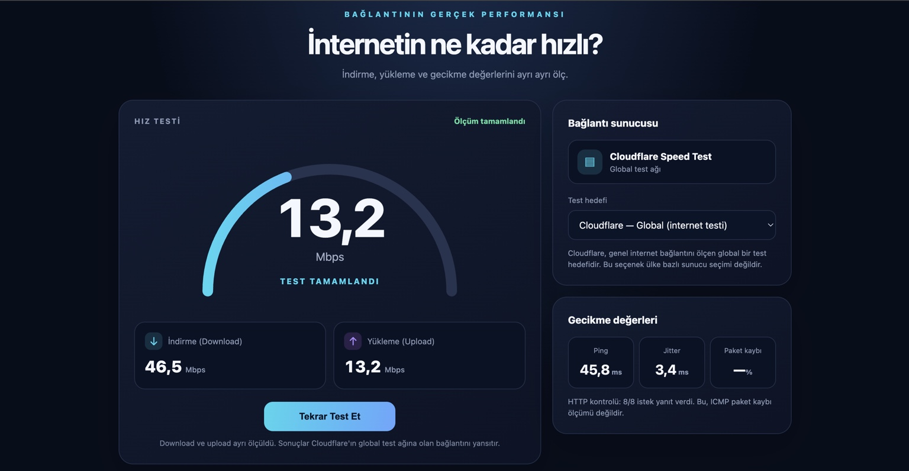
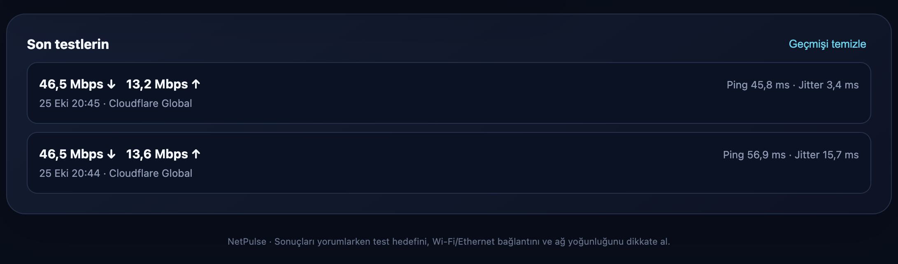

# NetPulse — İnternet Hız Testi

NetPulse, internet bağlantısının indirme ve yükleme hızını ayrı ayrı ölçmek ve gecikme değerlerini görüntülemek için hazırlanmış, Türkçe arayüze sahip hafif bir web uygulamasıdır.

## Ekran görüntüleri

### Hız testi


### Son testler


## Özellikler

- İndirme (download) ve yükleme (upload) hızını ayrı ayrı ölçme
- Ping ve jitter değerlerini gösterme
- Son testleri tarayıcıda görüntüleme
- Mobil ve masaüstü ekranlarına uyumlu arayüz
- Cloudflare Global test hedefi

> **Ölçüm notu:** Cloudflare Global, ülke bazında sunucu seçimi değildir. Ping/jitter değerleri HTTP istekleri üzerinden yaklaşık ölçülür; paket kaybı için gerçek ICMP ölçümü yapılmaz. Sonuçlar cihaz, Wi‑Fi/Ethernet bağlantısı, ağ yoğunluğu ve test hedefine göre değişebilir.

## Gereksinimler

- Node.js 18 veya üzeri

## Yerel çalıştırma

```bash
npm start
```

Tarayıcıda `http://localhost:3000` adresini aç.

## Portu değiştirme

Varsayılan port `3000`'dir. Başka bir uygulamayla çakışırsa farklı port seçebilirsin.

macOS/Linux:
```bash
PORT=3001 npm start
```

Windows PowerShell:
```powershell
$env:PORT=3001; npm start
```

Sunucuda Todo List uygulaması çalışıyorsa, NetPulse için Todo List'ten farklı bir port kullan. İnternete açmadan önce ters proxy/firewall ayarlarını da buna göre yapılandır.

## GitHub'a yükleme

GitHub'da boş bir `netpulse` deposu oluşturduktan sonra proje klasöründe:

```bash
git init
git add .
git commit -m "NetPulse uygulamasını ve ekran görüntülerini ekle"
git branch -M main
git remote add origin https://github.com/dmrt-57/netpulse.git
git push -u origin main
```

Depo zaten GitHub'da oluşturulmuşsa `git remote add origin ...` komutunu tekrar çalıştırma; önce `git remote -v` ile kontrol et.

## Lisans

Bir lisans seçilene kadar proje için özel kullanım koşulları geçerlidir.
